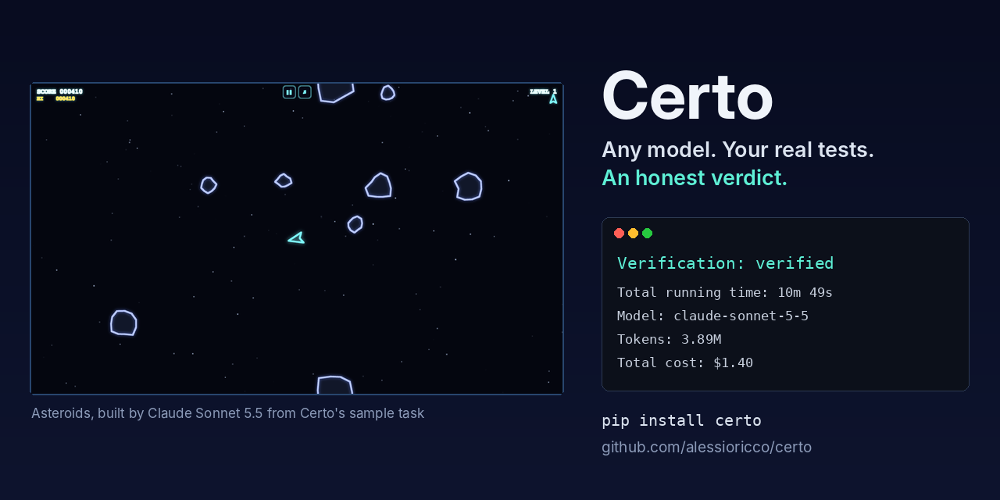
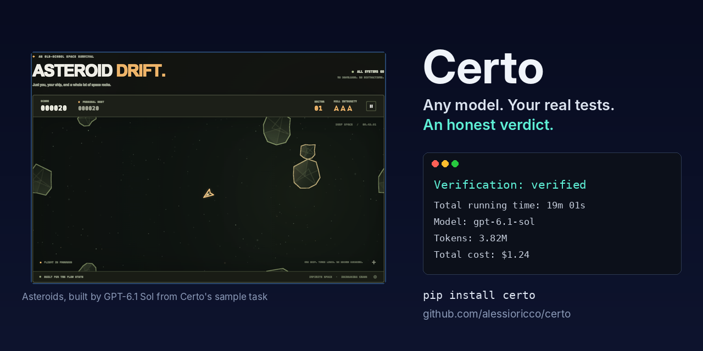
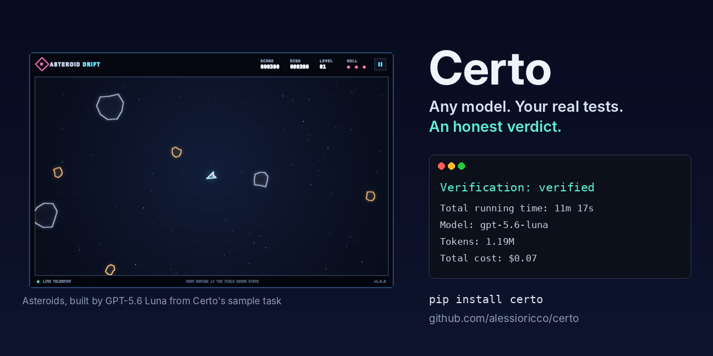
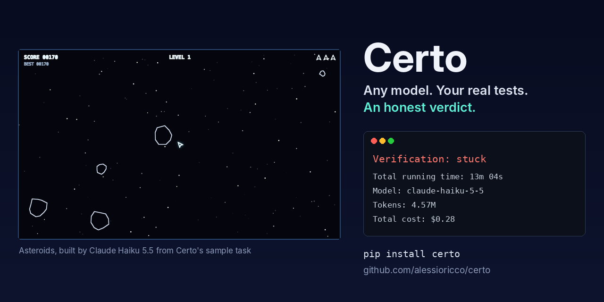

# Five models build Asteroids (Certo 0.1.19)

One run of [Compare models on one task](../guides/compare-models-on-a-task.md):
the same task, a browser Asteroids game, given to five models one after
the other. It shows what a model comparison looks like on a task bigger
than the benchmark's, and what Certo's verdict did and didn't catch. It
is one run per model, so it is a first look, not a ranking: for that, see
the [benchmark](../guides/benchmark.md).

## The setup

- **Certo:** 0.1.19, from a source checkout. **Run:** 2026-10-19, from
  16:54 to 17:50 UTC, one model after the other.
- **Task:** [examples/asteroids.md](https://github.com/alessioricco/certo/blob/main/examples/asteroids.md),
  a complete browser game in JavaScript, with tests for the game logic
  and every configured build, test, lint and type check passing.
- **Settings:** the defaults. Checks on, up to 2 fix attempts, 30
  minutes and 50 steps per model.
- **Machine:** Darwin 25.6.0, arm64, Apple M1, 16 GB RAM, Node 22.
  `qwen3.8:27b` ran on Ollama on another machine.

## Results

| Model | Certo's verdict | `certo verify` afterwards | Tests it wrote | Time | Cost |
|---|---|---|---|---|---|
| `anthropic/claude-sonnet-5-5` | `verified` | `verified`: build, test, lint | 52 | 10m 49s | $1.40 |
| `openai/gpt-6.1-sol` | `verified` | `verified`: build, test, lint | 15 | 19m 01s | $1.24 |
| `openai/gpt-5.6-luna` | `verified` | `verified`: build, test, lint, typecheck | 6 | 11m 17s | **$0.07** |
| `anthropic/claude-haiku-5-5` | `stuck` | `failed`: lint | **0** | 13m 04s | $0.28 |
| `ollama/qwen3.8:27b` | `inconclusive` | nothing to check | none | 31s | $0.00 |

`certo verify` re-ran the project's checks with no model, after all the
runs had ended. Each screenshot shows the game running in a browser.

### Claude Sonnet 5.5: `verified`



The most tests by far (52), and the build, tests and lint all pass. The
most expensive run.

### GPT-6.1 Sol: `verified`



The slowest of the three that finished: 19 minutes, almost twice the
others. 15 tests; the build, tests and lint pass.

### GPT-5.6 Luna: `verified`



A complete game for 7 cents, about a twentieth of what Sonnet and Sol
cost. It is the only one of the three with a type check, which passed
too. Only 6 tests: fewer tests means a `verified` verdict proves less.

### Claude Haiku 5.5: `stuck`



The game runs, as the screenshot shows, but the run didn't finish. Haiku
used all 50 of its steps while still editing, so the run ended before
the agent said it was done. Certo doesn't check a run that never finished
properly, so the verdict is `stuck`. Checking the folder afterwards with
`certo verify` found two things:

- **Lint fails**: one file doesn't parse (`Parsing error: Unexpected
  token <`).
- **There are no tests.** The `tests/` folder is empty, although the
  task asks for tests. `npm test` still passes, because `node --test`
  succeeds when it finds no test file. Certo counts that as a pass today,
  a known gap (see below).

### qwen3.8:27b: `inconclusive`

No screenshot: nothing was built. The model's first answer was a tool
call written as plain text instead of a real one:

```text
{"command": "view", "path": "/Users/.../projects/ollama-qwen3-8-27b"}
```

The agent framework read it as the final message, so the run ended after
31 seconds with an empty folder, and Certo said `inconclusive`: nothing
to check, not a pass. The same model passed 27 of 27 small tasks in the
[0.1.18 local benchmark](baseline-0.1.18-local.md). Some local models, on
some Ollama setups, do this; see
[Choose a local model](../guides/choose-a-local-model.md#what-makes-a-local-model-work-with-certo).

## What it shows

- **For a game like this, the cheap model was enough.** Luna's game ran
  and was `verified` for $0.07. Sonnet and Sol put more tests and more
  work into their projects, for about twenty times the cost.
- **`verified` is as strong as the tests behind it.** Sonnet's verdict
  rests on 52 tests, Luna's on 6. Both are honest, but they don't prove
  the same amount. Look at the tests before trusting the verdict.
- **A running game isn't a checked one.** Haiku's game runs, but its
  project fails lint and has no tests, and the run never finished. Certo
  can't see that a game plays well; it checks what the project's own
  build, tests and lint check.
- **No verdict claimed more than it had.** Each run that didn't finish,
  or produced nothing, ended `stuck` or `inconclusive`, never `verified`.

## What Certo will do better

Two gaps this run showed, both on the TODO list:

- **A run that uses all its steps should still be checked.** Haiku's work
  was there; checking it would have shown `failed` at once, instead of
  `stuck` with no check.
- **"No tests" shouldn't pass for Node.** `node --test` succeeds with no
  test file, so a Node project with no tests can look tested. Here lint
  failed anyway; on a project with clean lint, it would have been
  `verified`.

## Reproduce it

With the script from [Compare models on one task](../guides/compare-models-on-a-task.md),
these five lines, and the keys exported:

```bash
run anthropic/claude-sonnet-5-5   ANTHROPIC_API_KEY
run anthropic/claude-haiku-5-5    ANTHROPIC_API_KEY
run openai/gpt-6.1-sol            OPENAI_API_KEY
run openai/gpt-5.6-luna           OPENAI_API_KEY
run ollama/qwen3.8:27b            ""  http://localhost:11434
```

```bash
./compare-models.sh examples/asteroids.md
```

The four cloud runs cost $3.00 in all. Your results will differ: a model
does better on some runs than others.
